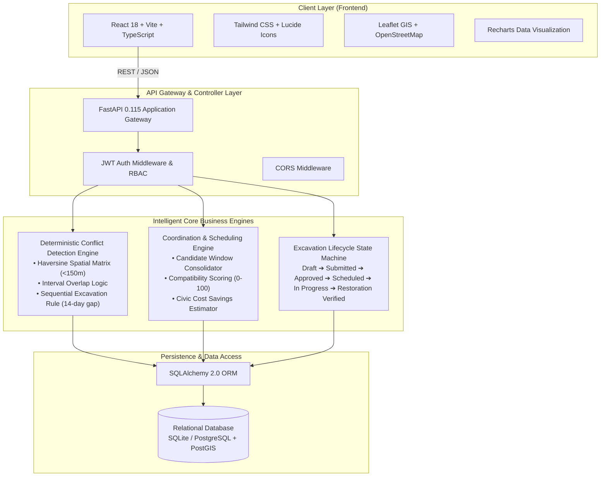

# Infrasync — System Architecture

## 1. Overview
**Infrasync** is an AI-powered urban road excavation coordination platform designed for municipal corporations (demonstrated for Pune, Maharashtra). It decouples independent utility excavation planning into a unified, collaborative decision-support workflow.

## 2. Layer Descriptions

### 2.1 Frontend Client Layer
- **Framework**: React 18 with TypeScript and Vite bundler for instant HMR.
- **Styling**: Tailwind CSS utilizing an authoritative civic palette (Deep Navy `#0F172A`, Slate `#1E293B`, Department-specific color tokens).
- **GIS Mapping**: Leaflet.js with OpenStreetMap tiles rendering verified Pune road alignments (Central Avenue, FC Road, Karve Road, Baner Road, etc.).
- **Data Visualizations**: Recharts for agency volume, temporal trends, and cost-comparison graphs.

### 2.2 Backend Gateway Layer
- **FastAPI**: Asynchronous Python API gateway featuring Pydantic request validation and automated OpenAPI documentation (`/docs`).
- **Authentication**: JWT Bearer tokens with server-side Role-Based Access Control (`admin`, `department_user`, `viewer`).

### 2.3 Business Logic Engines
- **Conflict Detection Engine**: Real-time deterministic evaluation of spatial proximity (Haversine great-circle formula) and temporal overlap intervals. Identifies clashes, emergency warnings, and repeated excavation on the same corridor within 14 days.
- **Coordination & Scheduling Engine**: Formulates candidate joint excavation corridors, computes feasibility ratings, calculates duplicate asphalt restoration cost savings, and facilitates departmental voting.
- **Restoration Certification**: Separates excavation completion from asphalt verification, requiring municipal laboratory/engineer sign-off.
