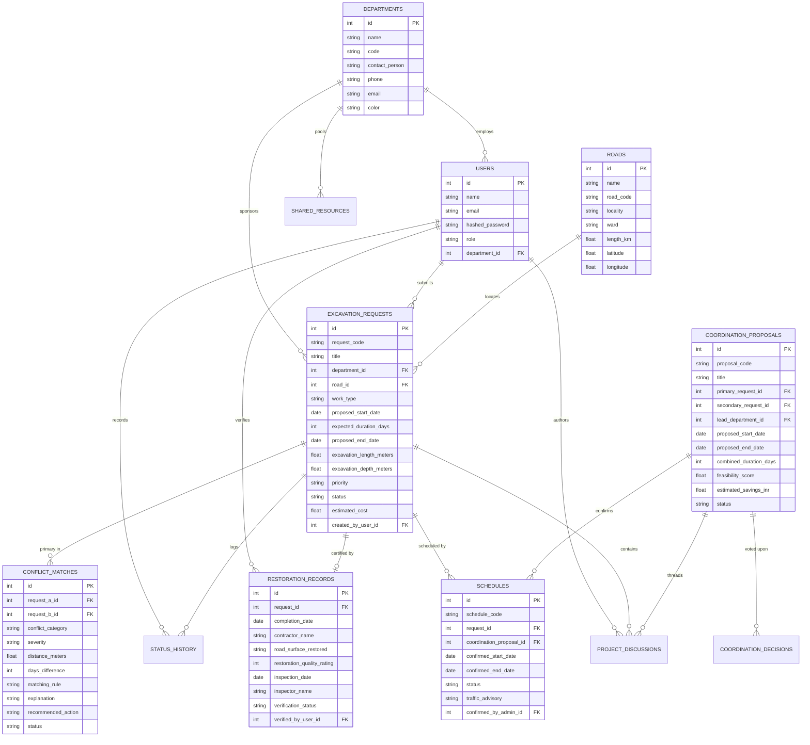

# Infrasync — Entity Relationship Diagram (ERD)

## 1. Relational Schema Architecture

## 2. Integrity & Constraints
1. **Request Uniqueness**: `request_code` follows the immutable format `REQ-YYYY-NNN`.
2. **Deterministic Distance Threshold**: Geographic coordinates are indexed and verified against Pune city bounding boxes ($18.4^\circ\text{N} - 18.6^\circ\text{N}$, $73.7^\circ\text{E} - 74.0^\circ\text{E}$).
3. **Decoupled Lifecycle**: Road restoration is recorded in `RESTORATION_RECORDS`, preventing a completed excavation from automatically pretending the road surface has been restored.
