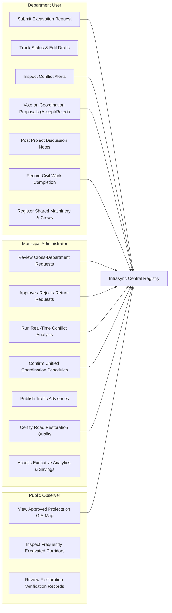

# Infrasync — Use-Case Model & User Journeys

## 1. Actor Hierarchy
- **Department User** (Water, Electricity, Gas, Telecom, Drainage, Road)
- **Municipal Administrator** (Municipal Commissioner, Chief Road Engineer)
- **Public / Read-Only Observer** (Citizen Forum, Traffic Cell)

## 2. Use-Case Diagram

## 3. Core Workflow Scenarios

### Scenario 1: Cross-Departmental Collision Resolution (End-to-End Evaluation Scenario)
1. **PMC Water Supply Officer** submits `REQ-2026-001` for a 400mm feeder pipe repair on Central Avenue (Oct 15–18). Request is approved.
2. **MSEDCL Electricity Engineer** submits `REQ-2026-002` for 11kV cable fault rectification on Central Avenue (Oct 17–20).
3. The **Conflict Detection Engine** triggers automatically upon submission:
   - Detects spatial overlap (same road corridor, coordinates within 25 meters).
   - Detects temporal overlap (Oct 17–18 = 2 overlapping days).
   - Classifies conflict as `Direct Spatial & Temporal Overlap` under `RULE_SPATIAL_TEMPORAL_OVERLAP`.
4. System automatically formulates **Coordination Proposal** `PROP-2026-001`:
   - Computes feasibility score: 85%.
   - Recommends unified excavation window: Oct 15 to Oct 18 (4 days).
   - Projects ₹38,400 civic cost savings by eliminating duplicate asphalt repaving.
5. Both department officers review and vote **Accept** in the coordination portal.
6. **Municipal Administrator** confirms the unified schedule, sets traffic diversion advisories, and automatically shifts both requests to **Scheduled**.
7. Once excavation is done, the contractor applies asphalt and the Municipal Road Engineer performs site inspection, certifying status as **Restoration Verified**.
